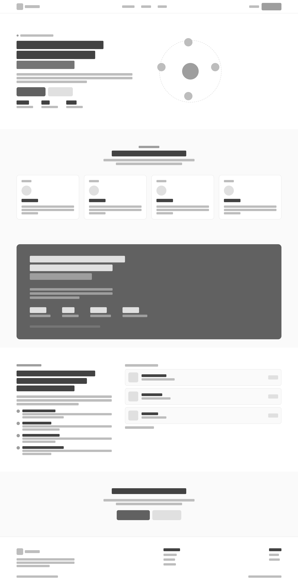
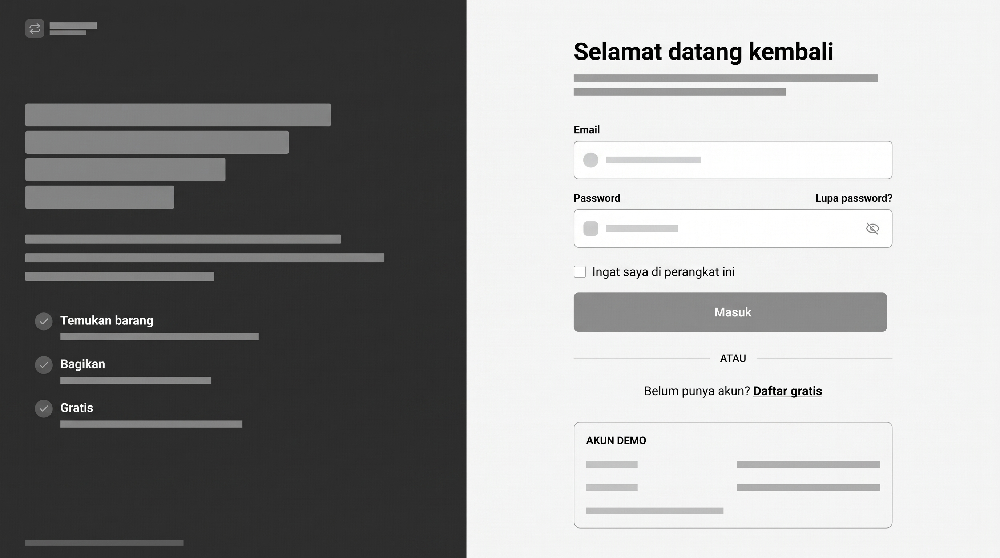
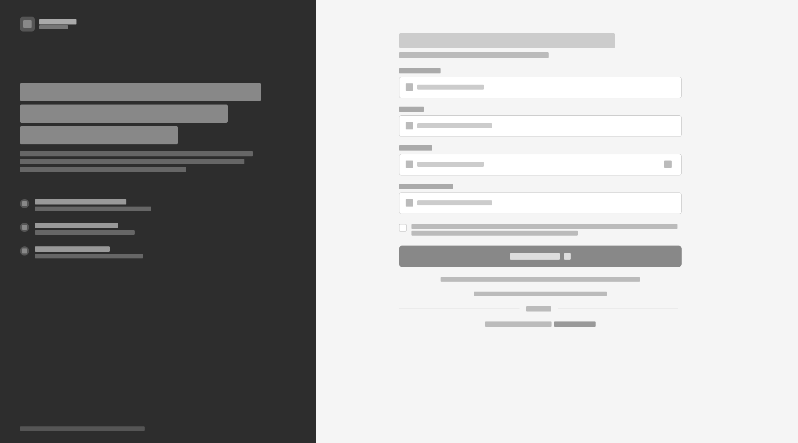
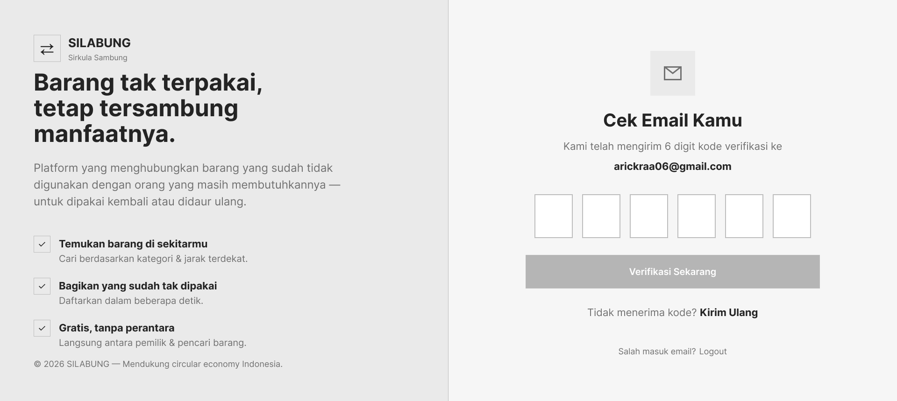
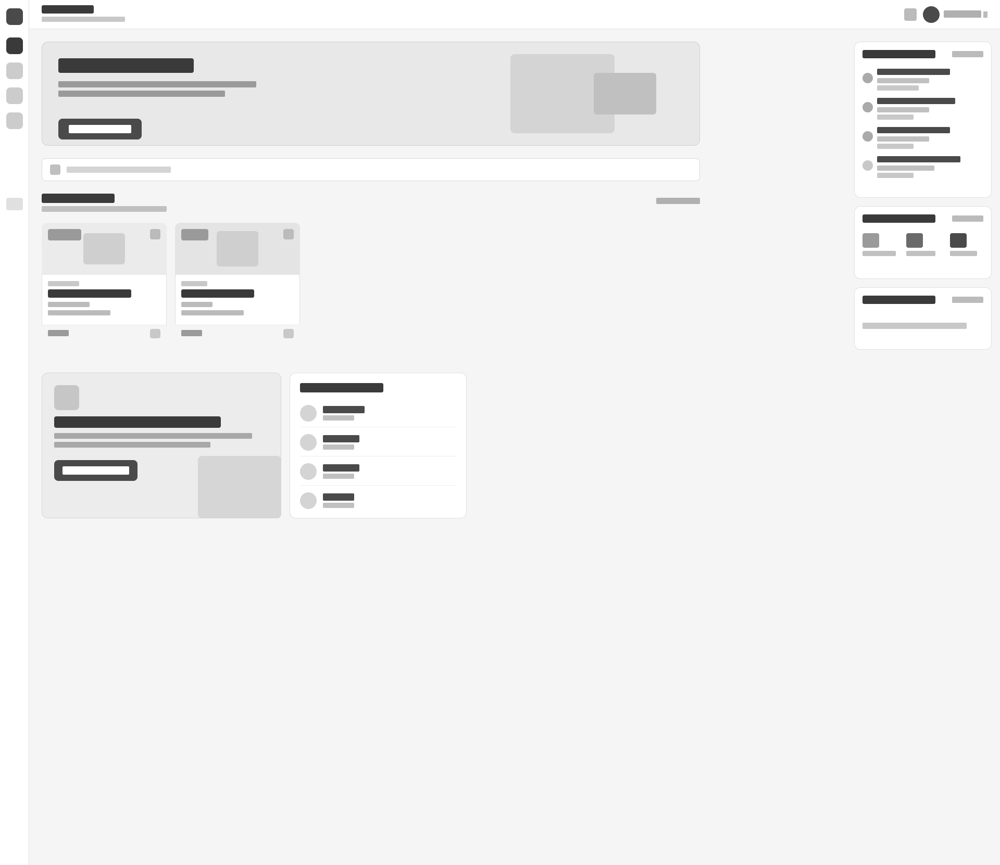
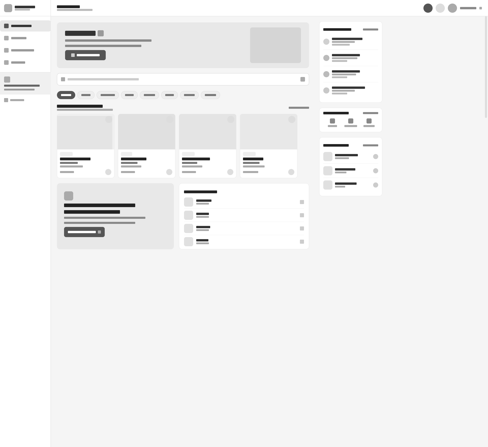

# 🌱 SILABUNG (Sirkula Sambung)

> **"Barang tak terpakai, tetap tersambung manfaatnya."**

SILABUNG adalah platform berbasis web yang dirancang untuk menghubungkan orang yang memiliki barang layak pakai namun sudah tidak digunakan (Supplier) dengan orang yang membutuhkannya (Customer). Berfokus pada prinsip *circular economy* (reuse & recycle), SILABUNG hadir sebagai solusi penumpukan barang di lingkungan kos dan rumah tangga.

---

## 📌 1. Inovasi dan Relevansi Solusi 

**Masalah Nyata:**
Mahasiswa sering kali menumpuk barang (pakaian, buku, peralatan) di kos atau rumah karena bingung harus menyalurkannya ke mana. Di sisi lain, mahasiswa perantau, keluarga kurang mampu, atau penghuni panti asuhan justru membutuhkan barang-barang tersebut. Kebutuhan ini tidak terpenuhi bukan karena tidak ada yang memberi, melainkan karena **pemberi dan penerima tidak saling terhubung**.

**Solusi & Keunggulan SILABUNG:**
1. **Bukan Marketplace Biasa:** Tidak ada transaksi uang/komisi. Fokus murni pada *resource matching* (pencocokan sumber daya).
2. **Smart Matching Wishlist:** Fitur inovatif di mana Customer dapat menginput daftar kebutuhan (multi-item). Sistem akan otomatis mensortir dan mengalokasikan barang dari beberapa Supplier terdekat secara cerdas (menggunakan algoritma *greedy fill*).
3. **Location-Based Discovery:** Menampilkan jarak (menggunakan rumus Haversine) dan peta interaktif (Leaflet) agar pengambilan barang lebih efisien.
4. **Verifikasi Ketat (Anti-Fraud):** Memastikan Supplier adalah benar-benar mahasiswa/alumni kampus dengan memvalidasi dokumen (KTM/KRS/SKL) menggunakan **Digital Image Forensics (EXIF Metadata)**.

---

## 🎯 2. Kesesuaian dengan Kebutuhan Pengguna 

**Target Pengguna:**
*   **Customer:** Mahasiswa (tugas/penelitian), pengrajin, komunitas, masyarakat umum.
*   **Supplier:** Mahasiswa Universitas Pelita Bangsa (UPB) dan sekitarnya yang memiliki barang tak terpakai.

**Alur Pengguna (User Flow):**
1. **Onboarding & Verifikasi:** User mendaftar -> Verifikasi Email (OTP 6 digit) -> Memilih Role (Customer/Supplier) -> Supplier wajib upload KTM/KRS.
2. **Supplier Flow:** Tambah Barang -> Kelola Stok -> Terima/Tolak Permintaan -> Serah Terima via Kode Verifikasi.
3. **Customer Flow:** Cari Barang / Buat Wishlist Pintar -> Ajukan Permintaan -> Chat via WhatsApp -> Ambil Barang menggunakan Kode Verifikasi.

---

## ⚙️ 3. Kualitas Teknis dan Fungsionalitas 

**Tech Stack:**
*   **Framework:** Laravel 11 (PHP 8.2+)
*   **Database:** MySQL
*   **Frontend:** Tailwind CSS, Vanilla JavaScript
*   **Maps API:** Leaflet.js + OpenStreetMap

**Arsitektur & Keamanan:**
*   **Modular Code:** Menggunakan pola MVC (Model-View-Controller) Laravel yang rapi, dipisah berdasarkan domain (`Customer`, `Supplier`, `Auth`).
*   **Reusable Components:** UI dibangun menggunakan Blade Components (`<x-avatar>`, `<x-item-card>`, dll) sehingga *maintainable*.
*   **Keamanan Autentikasi:** Role-Based Access Control (RBAC) yang ketat, dilengkapi sistem verifikasi Email OTP.
*   **Validasi Berlapis:** Backend (Laravel Validation) dan Frontend memastikan tidak ada *request* cacat yang masuk ke database.

---

## 🎨 4. Kualitas Desain UI/UX 

*   **Desain System:** Menggunakan *Design Tokens* yang konsisten (Primary Green: `#16A34A`, Dark Green: `#166534`, Background: `#F8FAF8`) dan font modern (Plus Jakarta Sans).
*   **Responsive & Mobile-First:** Tampilan dioptimalkan untuk HP (Bottom Navigation) dan Desktop (Sidebar). 
*   **Dark Mode:** Mendukung mode gelap yang ramah mata, diimplementasikan menggunakan CSS override yang ringan.
*   **Usability & Accessibility:** 
    *   *Feedback* interaktif (Toast notifications, Modal konfirmasi).
    *   *Empty States* yang ramah (tidak ada halaman kosong yang membingungkan).
    *   Form input dilengkapi label yang jelas dan *focus states*.

---

## 📚 5. Dokumentasi dan Kelengkapan Proposal 

### 🚀 Cara Menjalankan Project (Local Development)

**Prasyarat:** PHP >= 8.2, Composer, Node.js & NPM, MySQL (XAMPP/Laragon).

1. **Clone Repository:**
    ```bash
    git clone https://github.com/arckra/SilaBung.git
    cd SilaBung
    ```

2. **Install Dependencies:**
    ```bash
    composer install
    npm install
    ```

3. **Konfigurasi Environment:**
Duplikat file .env.example menjadi .env.
    ```bash
    cp .env.example .env
    php artisan key:generate
    ```
Buka .env dan atur koneksi database serta konfigurasi email (SMTP Gmail/Mailtrap) untuk fitur OTP.

4. **Migrasi Database & Storage Link:**
    ```bash
    php artisan migrate --seed
    php artisan storage:link
    ```

5. **Build Frontend & Jalankan Server:**
    ```bash
    npm run build
    php artisan serve
    ```

## 🔮 Proyeksi Pengembangan Sistem (Roadmap)
Fase 2: Integrasi AI untuk klasifikasi gambar barang otomatis, fitur pickup delivery, dan sistem rating reputasi antar user.

Fase 3: Kemitraan resmi dengan Bank Sampah setempat dan integrasi Dashboard Dampak Karbon (Carbon Footprint Calculator).

## 📱 Prototype & Wireframe








## 👨‍💻 Tim Pengembang
Dibuat dengan ❤️ untuk Lomba Web Development.

Ari Cakra Kurniawan - Full-Stack Developer

Friska Pebriana Lestari - UI/UX Designer

Nadia Aulina Safari - Product & Riset
